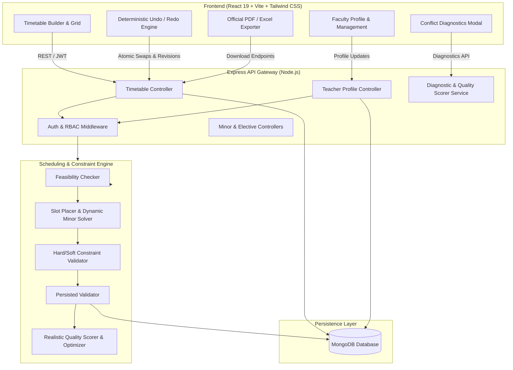

# AI Timetable Maker

An intelligent, institutional-grade academic timetable management and constraint-aware scheduling platform. Built for university engineering departments, the system automates conflict-free scheduling across classes, faculty, laboratories, and synchronized elective/minor baskets, providing real-time diagnostics, deterministic undo/redo state management, and official export generation.

---

## Table of Contents

- [Overview](#overview)
- [System Architecture](#system-architecture)
- [Institutional Scheduling Rules & Policies](#institutional-scheduling-rules--policies)
  - [1. Faculty Rest-Period Policy & Guaranteed Rest Gap](#1-faculty-rest-period-policy--guaranteed-rest-gap)
  - [2. Dynamic Global Minor-Track Synchronization](#2-dynamic-global-minor-track-synchronization)
  - [3. Institutional Laboratory Allocation Matrix](#3-institutional-laboratory-allocation-matrix)
  - [4. Mandatory Elective Basket Synchronization](#4-mandatory-elective-basket-synchronization)
  - [5. Daily Subject Uniqueness & Workload Conservation](#5-daily-subject-uniqueness--workload-conservation)
  - [6. Realistic Quality Scoring Model](#6-realistic-quality-scoring-model)
  - [7. Interactive Conflict Diagnostics & Optimization Intelligence](#7-interactive-conflict-diagnostics--optimization-intelligence)
  - [8. Deterministic Undo/Redo Engine & Atomic Swapping](#8-deterministic-undoredo-engine--atomic-swapping)
  - [9. Teacher Profile Management & Synchronized Name Propagation](#9-teacher-profile-management--synchronized-name-propagation)
- [Technology Stack](#technology-stack)
- [Project Structure](#project-structure)
- [Engine Pipeline & Verification Gates](#engine-pipeline--verification-gates)
- [REST API Reference](#rest-api-reference)
- [Installation & Local Setup](#installation--local-setup)
- [Verification & Automated Test Suite](#verification--automated-test-suite)
- [License](#license)

---

## Overview

Academic timetable scheduling in higher education institutions involves strict combinatorial constraints:

- **Faculty Workload & Rest Gaps**: Every instructor must receive sufficient breathing room throughout the teaching day. No instructor may be assigned 3 or more consecutive teaching periods without a rest gap.
- **Lunch Boundary Separation**: Midday lunch breaks (Mon–Thu between P3 and P4; Friday between P4 and P5) physically reset fatigue runs. Consecutive teaching across lunch is prohibited from being counted as back-to-back fatigue.
- **Physical Laboratory Isolation**: Practicals must follow exact institutional room assignments without double-booking. S1/S2 practicals are restricted to Lab 1–3; S3–S8 practicals and mini-projects are restricted to Lab 4; S8 Capstone Project is assigned dedicated rooms.
- **Dynamic Minor Synchronization**: S4 CSE A and S4 CSE B taking university Minor tracks must have identical time slots selected dynamically by the scheduler, avoiding hardcoded time slots.
- **Synchronized Electives**: Paired class sections sharing an elective basket must have identical periods.

**AI Timetable Maker** solves these challenges using a deterministic multi-stage constraint-satisfaction engine coupled with local search optimization and interactive administrative tooling.

---

## System Architecture



---

## Institutional Scheduling Rules & Policies

### 1. Faculty Rest-Period Policy & Guaranteed Rest Gap
- **Hard Constraint (`FACULTY_REST_GAP`)**: A maximum of 2 consecutive teaching periods is permitted globally across all classes, sections, and departments. 3 or more consecutive teaching periods without a free period are strictly prohibited.
- **Lunch Boundary Reset**:
  - **Monday–Thursday**: Lunch break occurs between Period 3 and Period 4. Periods P3 and P4 are physically separated by lunch and are **not** consecutive teaching periods.
  - **Friday**: Jum'ah / Lunch break occurs between Period 4 and Period 5. Periods P4 and P5 are physically separated by lunch.
- **Rest Optimization Preference**: The scheduling optimizer prioritizes the alternating pattern `Teaching -> Free -> Teaching -> Free -> Teaching` to prevent educator fatigue.
- **3-Period Lab Instructor Staggering**: In 3-period laboratory blocks, primary and co-instructors are staggered (Period 1: Primary; Period 2: Primary + Co-instructor; Period 3: Co-instructor) ensuring that no instructor exceeds 2 consecutive periods during practicals.

### 2. Dynamic Global Minor-Track Synchronization
- **Dynamic Slot Discovery**: Removes all legacy hardcoded Minor period assumptions (`Mon P3, Thu P3, Fri P4, Fri P6`). The engine dynamically computes common free periods across participating sections.
- **Section Synchronization**: S4 CSE A and S4 CSE B receive 100% identical Minor-track day and period slots.
- **Sub-Minor Parallelism**: Within each synchronized Minor slot, parallel sub-minor tracks (`Minor / OS`, `Minor / DBMS`, `Minor / COA`, `Minor / Mathematics`) run concurrently without teacher collisions.

### 3. Institutional Laboratory Allocation Matrix
- **Semester 1 & 2 Practicals**: Strictly restricted to `Lab 1`, `Lab 2`, or `Lab 3`. Practicals for S1/S2 are prohibited from occupying `Lab 4`.
- **Semester 3 to 8 Practicals & Mini-Projects**: Strictly assigned to designated `Lab 4`. Practicals for S3–S8 are prohibited from using `Lab 1`, `Lab 2`, or `Lab 3`.
- **Single-Occupancy Lab 4**: The engine enforces absolute zero double-booking for `Lab 4`. No two classes can occupy Lab 4 simultaneously.
- **S8 Capstone Project Phase-2 (`CST416`/`CSD416`)**:
  - Assigned dedicated physical classrooms: `Room 501` (S8 CSE A) and `Room 502` (S8 CSE B) on Thursday (Periods 1–6) and Friday (Periods 1–6).
  - Supervised by Dr. S Gunasekaran, assisted by the `Project Committee` on P3 & P6 (Thu) and P3 & P4 (Fri) to respect the 2-period rest gap limit.

### 4. Mandatory Elective Basket Synchronization
- Paired sections sharing an elective basket (e.g., S4 Professional Elective 1, S8 Electives) are locked into identical day and period coordinates.
- **Bidirectional Movement**: Dragging or swapping an elective slot in Section A automatically synchronizes the corresponding slot in Section B, preventing cross-section elective divergence (`ELECTIVE_DESYNCHRONIZATION`).

### 5. Daily Subject Uniqueness & Workload Conservation
- **Theory Distribution**: Under-scheduled theory courses are prohibited from scheduling excess periods on a single day unless mathematically required by high-credit loads ($\ge 5$ hours) or compressed schedules (e.g., S8 3-day window).
- **Workload Conservation**: Weekly lecture, tutorial, and practical contact hours strictly match KTU syllabus credit requirements.

### 6. Realistic Quality Scoring Model
- **No Fictitious 100/100 Scores**: The quality scorer evaluates both hard conflicts and soft warnings. Timetables with conflicts or warnings are realistically scored (e.g., 15/100 to 81/100) using weighted deductions:
  $$\text{Score} = 100 - (\text{HardConflicts} \times 8) - (\text{SoftWarnings} \times 0.6) - (\text{Unplaced} \times 10)$$
- **Publishability Gate**: A timetable version is only publishable if it has 0 unplaced subjects and 0 hard conflicts.

### 7. Interactive Conflict Diagnostics & Optimization Intelligence
- **Clickable Badges**: Diagnostic indicators in Quick Timetable (`Hard Conflicts`, `Soft Warnings`, `Optimization`) are fully interactive with "About & Issues ▾" subtitles.
- **Issue Diagnostics Modal**: Clicking any badge opens the modal showing:
  - Affected Class, Day, Period, Subject, Faculty, and Room
  - Detailed description and failure justification
  - Underlying Root Cause analysis
  - Actionable Recommended Resolution
  - **Locate in Grid**: Highlights and focuses the conflicting cell directly in the timetable grid.

### 8. Deterministic Undo/Redo Engine & Atomic Swapping
- **Atomic Multi-Period Swapping**: Swapping a multi-period laboratory block automatically displaces or exchanges the complete contiguous block.
- **State History**: Full undo and redo capabilities for manual swap operations with instant database synchronization.

### 9. Teacher Profile Management & Synchronized Name Propagation
- **RESTful Endpoints**: Full CRUD support (`create`, `update`, `getById`) in `teacherService.js` and `teacherController.js`.
- **Field Support**: Supports `designation`, `maxPeriodsPerWeek`, and `unavailability`.
- **Faculty Name Correction**: Corrected `Mr Sangeeth` to `Ms Sangeetha` across all MongoDB records, active timetable snapshots, and JSON caches.

---

## Technology Stack

- **Frontend**: React 19, Vite, Tailwind CSS, Lucide Icons, Canvas Confetti
- **Backend**: Node.js, Express.js, MongoDB, Mongoose
- **Testing & Verification**: Playwright E2E, Node.js Assertions
- **Export Engines**: PDFKit, ExcelJS

---

## Project Structure

```
AI_TIMETABLE_MAKER/
├── scripts/
│   ├── master_verification_suite.js     # 7-point integration test suite
│   ├── capture_ui_verification.js       # Playwright E2E UI screenshot script
│   └── correct_sangeetha_name.js        # Faculty name synchronization script
├── timetable-system/
│   ├── backend/
│   │   ├── src/
│   │   │   ├── controllers/             # Timetable, teacher, and auth controllers
│   │   │   ├── models/                  # Mongoose schemas (Timetable, Teacher, Class)
│   │   │   └── services/engine/         # Core constraint and scheduling engine
│   │   │       ├── constraintValidator.js # Hard/soft rule validation
│   │   │       ├── dataLoader.js        # Normalized academic data hydration
│   │   │       ├── diagnosticService.js  # Diagnostic explanations and root causes
│   │   │       ├── orchestrator.js       # Multi-pass schedule orchestrator
│   │   │       ├── qualityScorer.js      # Realistic score calculation
│   │   │       ├── slotPlacer.js         # Placement engine and rest-gap logic
│   │   │       └── subMinorSolver.js     # Dynamic minor allocation solver
│   │   └── server.js                    # Express application entrypoint
│   └── frontend/
│       ├── src/
│       │   ├── components/timetable/    # ConflictDiagnosticsModal, VersionHistory
│       │   ├── pages/admin/             # TimetableBuilder, FacultyProfile
│       │   └── services/                # teacherService, timetableService
│       └── package.json
└── README.md
```

---

## Installation & Local Setup

### Prerequisites
- Node.js (v18+ or v20+)
- MongoDB running locally on `mongodb://127.0.0.1:27017`

### Setup Backend
```bash
cd timetable-system/backend
npm install
npm run dev
# Backend runs on http://127.0.0.1:5000
```

### Setup Frontend
```bash
cd timetable-system/frontend
npm install
npm run dev
# Frontend runs on http://localhost:5174
```

---

## Verification & Automated Test Suite

Run the master verification suite to test all institutional scheduling constraints:

```bash
node scripts/master_verification_suite.js
```

### Test Suite Coverage:
1. **Faculty Rest Gap**: Confirms lunch boundary separation and rejects $\ge 3$ consecutive periods.
2. **Dynamic Minor Sync**: Verifies identical Minor slots between S4 CSE A and S4 CSE B without faculty collisions.
3. **Laboratory Matrix**: Enforces Lab 1–3 for S1/S2 and Lab 4 for S3–S8.
4. **Faculty Name Correction**: Confirms Ms. Sangeetha is updated with 0 duplicates.
5. **Teacher Profile Service**: Validates `teacherService.create`/`update` and Edit Profile modal.
6. **Realistic Quality Scoring**: Ensures scores are mathematically deducted and never falsely 100/100.
7. **Diagnostics UI**: Verifies interactive diagnostic explanations and resolutions.

---

## License

This project is licensed under the MIT License.
