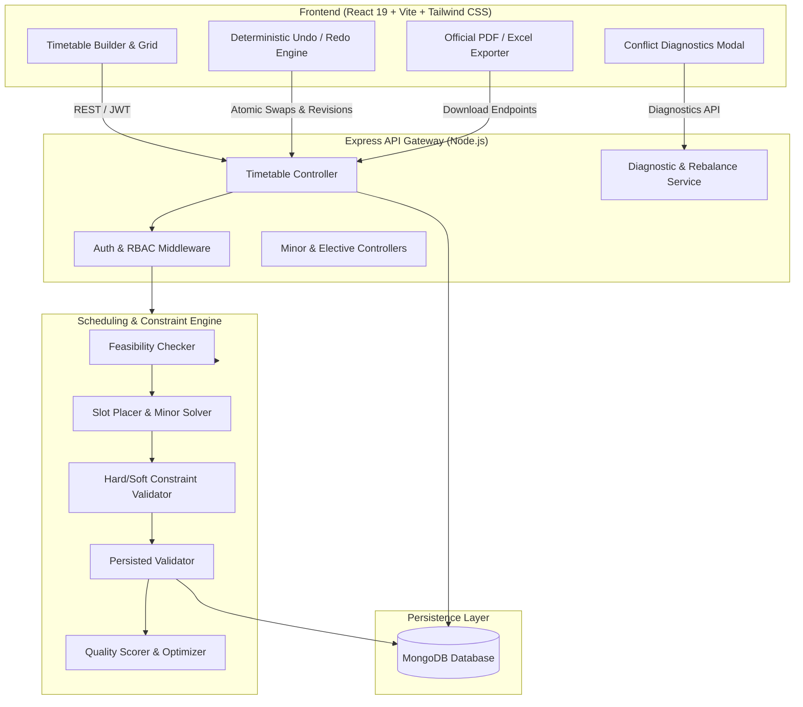

# AI Timetable Maker

An intelligent academic timetable management and constraint-aware scheduling platform. Built for university engineering departments, the system automates conflict-free scheduling across classes, faculty, laboratories, and synchronized elective baskets, providing real-time diagnostics, deterministic undo/redo state management, and official export generation.

---

## Table of Contents

- [Overview](#overview)
- [System Architecture](#system-architecture)
- [Core Scheduling Capabilities](#core-scheduling-capabilities)
  - [1. Configurable Minor Subject System](#1-configurable-minor-subject-system)
  - [2. Mandatory Elective Synchronization](#2-mandatory-elective-synchronization)
  - [3. Daily Subject Uniqueness & Workload Conservation](#3-daily-subject-uniqueness--workload-conservation)
  - [4. Atomic Laboratory Block Scheduling](#4-atomic-laboratory-block-scheduling)
  - [5. Conflict Diagnostics & Optimization Intelligence](#5-conflict-diagnostics--optimization-intelligence)
  - [6. Deterministic Undo/Redo Engine](#6-deterministic-undoredo-engine)
  - [7. Official Institutional Format Exports](#7-official-institutional-format-exports)
- [Technology Stack](#technology-stack)
- [Project Structure](#project-structure)
- [Engine Pipeline & Verification Gates](#engine-pipeline--verification-gates)
- [REST API Reference](#rest-api-reference)
- [Installation & Local Setup](#installation--local-setup)
- [Environment Variables](#environment-variables)
- [Testing & Quality Assurance](#testing--quality-assurance)
- [Security & Data Privacy](#security--data-privacy)
- [Known Limitations & Roadmap](#known-limitations--roadmap)
- [License](#license)

---

## Overview

Academic timetable scheduling in higher education institutions involves complex combinatorial constraints:

- Faculty cannot teach two classes simultaneously.
- Laboratory sessions require 2 to 3 contiguous periods and dedicated physical rooms without double-booking.
- Paired class sections (e.g., S4 CSE A and S4 CSE B) taking common elective baskets or university Minor subjects must have their periods strictly synchronized.
- Core KTU theory subjects should not repeat on the same day unless pedagogically required.
- Faculty daily workloads must remain balanced across all five working days (Monday to Friday).

**AI Timetable Maker** solves these challenges using a deterministic multi-stage constraint-satisfaction engine coupled with local search optimization and interactive administrative tooling.

---

## System Architecture



---

## Core Scheduling Capabilities

### 1. Configurable Minor Subject System
- **Semester 4 CSE Allocation**: Fixed 4 periods per week reserved for Minor subjects (`Monday P3`, `Thursday P3`, `Friday P4`, `Friday P6`).
- **Section Synchronization**: S4 CSE A and S4 CSE B are synchronized to the exact same slots to allow students across sections to attend cross-departmental Minor tracks.
- **Sub-Minor Specialization**: Supports multiple parallel sub-minors, each with its own subject code, faculty allocation, room assignment, and weekly hours.
- **Visual Distinctiveness**: Rendered in the timetable grid with distinct purple/amber `MINOR` badges (without redundant `/minor` label text).

### 2. Mandatory Elective Synchronization
- Paired sections sharing an elective basket (e.g., S4 Professional Elective 1) are locked into identical day and period coordinates.
- **Bidirectional Movement**: Dragging or swapping an elective slot in Section A automatically moves the corresponding slot in Section B, preventing cross-section elective divergence.

### 3. Daily Subject Uniqueness & Workload Conservation
- Core KTU theory subjects are restricted to at most **1 period per day** per section, distributing weekly lecture hours evenly from Monday through Friday.
- Total lecture, tutorial, practical, and research (L/T/P/R) hours are strictly conserved; the engine never increases or drops prescribed syllabus hours.

### 4. Atomic Laboratory Block Scheduling
- Multi-period laboratory sessions (2-hour or 3-hour blocks) are scheduled and relocated **atomically**.
- **Break Interval Integrity**: The placement solver guarantees lab blocks do not cross the afternoon lunch interval or the Friday prayer/lunch break.
- **Friday Constraint**: Prohibits 3-hour labs on Friday afternoon due to shorter 50-minute periods.
- **Room Collision Prevention**: Lab facilities (Lab 1 through Lab 4) are tracked globally across all academic departments to avoid double-booking.

### 5. Conflict Diagnostics & Optimization Intelligence
- Integrated diagnostic engine (`diagnosticService.js`) performing multi-pass validation across all generated timetables.
- **Classification**: Categorizes findings into `CRITICAL`, `ERROR` (Hard Conflicts), `WARNING` (Soft Scheduling Quality), `OPTIMIZATION` (Distribution Balance), and `INFO`.
- **Interactive UI Panel**: Clickable badges (`Hard Conflicts: 0 PASSED`, `Soft Warnings`) open an interactive modal with root-cause explanations and two-party conflict resolution breakdowns.
- **Direct Grid Targeting**: Clicking *"Locate in Grid"* closes the modal, sets the target class, displays a diagnostic focus banner, and rings the affected slot with an animated focus indicator.

### 6. Deterministic Undo/Redo Engine
- Complete revision tracking for manual timetable modifications.
- Stack-based state transitions persisted to MongoDB across page reloads.
- Branch invalidation: Applying a new modification after undo purges the forward redo history.
- **Input Typing Protection**: Global shortcut listeners for `Ctrl+Z`, `Ctrl+Y`, and `Ctrl+Shift+Z` ignore events originating from `<input>`, `<textarea>`, `<select>`, or `contentEditable` elements.

### 7. Official Institutional Format Exports
- **Ahalia Standard PDF**: Formal institution header, comprehensive subject and faculty legend table, and signature approval blocks for HoD and Principal.
- **All-Classes PDF Booklet**: Batch export compiling all semester sections into a unified print-ready booklet.
- **Teacher Personal Schedules**: Individual faculty timetables detailing class assignments, room numbers, and free preparation periods.

---

## Technology Stack

- **Frontend**: React 19, Vite, Tailwind CSS, Lucide Icons, DnD-Kit (drag-and-drop).
- **Backend**: Node.js, Express, Mongoose, PDFKit, ExcelJS.
- **Database**: MongoDB (Local or MongoDB Atlas).
- **Automated Testing**: Node.js Native Test Runner (`node --test`), Playwright (E2E browser automation).

---

## Project Structure

```
AI_TIMETABLE_MAKER/
├── .gitignore                      # Security exclusions, private data & export rules
├── README.md                       # Complete technical documentation
├── timetable-system/
│   ├── backend/
│   │   ├── src/
│   │   │   ├── config/             # Database connection, mailer, and system constants
│   │   │   ├── controllers/        # REST route handlers (Auth, Timetable, Teachers, etc.)
│   │   │   ├── middleware/         # JWT auth, rate limiting, and error handling
│   │   │   ├── models/             # Mongoose schemas (Timetable, MinorGroup, ElectiveGroup, etc.)
│   │   │   ├── routes/             # Express API routes
│   │   │   ├── services/
│   │   │   │   ├── engine/         # Feasibility checker, slot placer, diagnosticService
│   │   │   │   ├── pdfService.js   # Official Ahalia PDF generation engine
│   │   │   │   └── rebalanceService.js # Smart teacher swap and conflict rebalance engine
│   │   │   └── server.js           # Server bootstrap and connection lifecycle
│   │   ├── scripts/                # Database seed and maintenance utilities
│   │   └── tests/                  # Automated integration, engine, and Playwright E2E suites
│   └── frontend/
│       ├── src/
│       │   ├── components/
│       │   │   ├── timetable/      # TimetableGrid, SlotCell, ConflictDiagnosticsModal
│       │   │   ├── teachers/       # Faculty roster, workload forms, personal timetable modal
│       │   │   └── ui/             # Reusable design system (Modal, Button, Input, Table)
│       │   ├── pages/
│       │   │   ├── admin/          # TimetableBuilder, MinorSubjects, ElectiveGroups, Dashboard
│       │   │   ├── teacher/        # Teacher dashboard and personal timetable
│       │   │   └── public/         # Landing page, student viewer, login portals
│       │   ├── services/           # Axios API clients
│       │   └── App.jsx             # React router configuration and theme providers
│       ├── vite.config.js          # Vite build configuration
│       └── tailwind.config.js      # Styling and token setup
```

---

## Engine Pipeline & Verification Gates

The automated scheduling engine executes through distinct verification stages:

```
[ Academic Workload Inputs ]
             │
             ▼
┌───────────────────────────┐
│ 1. Feasibility Checker    │ ── Over-allocated hours? ──> Terminate with actionable error
└───────────────────────────┘
             │ Feasible
             ▼
┌───────────────────────────┐
│ 2. Locked Slot Allocation │ ── Places Minor subjects (Mon/Thu/Fri) & fixed Institutional slots
└───────────────────────────┘
             │
             ▼
┌───────────────────────────┐
│ 3. Elective Synchronization│ ── Places synchronized elective baskets across paired classes
└───────────────────────────┘
             │
             ▼
┌───────────────────────────┐
│ 4. Atomic Laboratory Blocks│ ── Places 2/3-period practicals with room allocation
└───────────────────────────┘
             │
             ▼
┌───────────────────────────┐
│ 5. Theory Slot Placement  │ ── Enforces 1-theory-per-day rule and faculty daily limits
└───────────────────────────┘
             │
             ▼
┌───────────────────────────┐
│ 6. Validation Gates       │ ── Evaluates hard constraints & persisted database records
└───────────────────────────┘
             │
             ▼
┌───────────────────────────┐
│ 7. Quality Scorer & Report│ ── Computes overall score & prepares conflict diagnostics
└───────────────────────────┘
```

---

## REST API Reference

### Timetable Management
| Method | Endpoint | Description |
|---|---|---|
| `POST` | `/api/timetable/generate` | Generates a new candidate timetable version |
| `GET` | `/api/timetable/versions` | Retrieves all timetable revisions and publication states |
| `GET` | `/api/timetable/versions/:id` | Retrieves full matrix slots for a specific timetable revision |
| `POST` | `/api/timetable/versions/:id/swap` | Performs an atomic slot swap with revision checks |
| `POST` | `/api/timetable/versions/:id/undo` | Reverts the previous slot modification from history |
| `POST` | `/api/timetable/versions/:id/redo` | Re-applies an undone slot modification |
| `GET` | `/api/timetable/versions/:id/diagnostics`| Returns full conflict, warning, and optimization diagnostics |
| `PUT` | `/api/timetable/versions/:id/accept` | Marks timetable as published and authoritative |

### Minor & Elective Administration
| Method | Endpoint | Description |
|---|---|---|
| `GET` | `/api/minor-groups` | Lists configured university Minor tracks and sub-minors |
| `POST` | `/api/minor-groups` | Creates or updates a Minor requirement group |
| `GET` | `/api/elective-groups` | Lists paired elective synchronization baskets |
| `POST` | `/api/elective-groups` | Registers synchronized elective pairings |

### Document Exports
| Method | Endpoint | Description |
|---|---|---|
| `GET` | `/api/timetable/versions/:id/export/ahalia-pdf` | Generates official Ahalia format PDF for a class |
| `GET` | `/api/timetable/versions/:id/export/all-classes-pdf` | Downloads complete all-classes PDF booklet |
| `GET` | `/api/timetable/versions/:id/export/all-classes-excel` | Generates institutional master Excel workbook |

---

## Installation & Local Setup

### Prerequisites
- **Node.js**: v18.x, v20.x, or v22.x
- **MongoDB**: Local Community Server (default `mongodb://127.0.0.1:27017/timetable_db`) or MongoDB Atlas
- **NPM**: v9.x or later

### 1. Clone the Repository
```bash
git clone https://github.com/anand-cpp/AI_TIMETABLE_MAKER.git
cd AI_TIMETABLE_MAKER/timetable-system
```

### 2. Backend Setup
```bash
cd backend
npm install
cp .env.example .env
npm run dev
```
The backend API initializes on `http://localhost:5000`.

### 3. Frontend Setup
In a new terminal:
```bash
cd timetable-system/frontend
npm install
npm run dev
```
The Vite development server runs on `http://localhost:5173` (or `http://localhost:5174`).

---

## Environment Variables

Safe template variables located in `timetable-system/backend/.env.example`:

| Variable | Description | Default / Example |
|---|---|---|
| `PORT` | Backend server port | `5000` |
| `MONGODB_URI` | MongoDB connection URI | `mongodb://127.0.0.1:27017/timetable_db` |
| `JWT_SECRET` | Secret key for signing JSON Web Tokens | `your-secure-jwt-secret-here` |
| `JWT_EXPIRES_IN` | Token expiration duration | `7d` |
| `CLIENT_URL` | Allowed CORS origins for frontend client | `http://localhost:5173,http://localhost:5174` |
| `NODE_ENV` | Runtime environment mode | `development` |

---

## Testing & Quality Assurance

### Backend Unit & Constraint Regression Tests
Execute constraint validation, atomic swap, and conflict diagnostic test suites:
```bash
cd timetable-system/backend
node --test tests/conflict_diagnostics_and_undo_redo_repair.test.js
node --test tests/master_optimization_faculty_balance_and_undo_redo.test.js
```

### Playwright End-to-End Test Suite
Automated headless browser suite testing complete user workflows:
```bash
cd timetable-system/backend
node tests/playwright_e2e_full_suite.js
```
The E2E test suite validates:
1. Public landing page and student schedule viewer.
2. Administrative authentication and dashboard KPIs.
3. Classes, teachers, subjects, and Minor subjects management.
4. Timetable grid matrix and `MINOR`, `LAB`, and `ELECTIVE` badge rendering.
5. Interactive Conflict Diagnostics Modal, tabs, and cell locator highlighting.
6. Undo/redo controls and form typing keyboard protection.
7. Faculty portal login and personalized teacher weekly timetable.

### Frontend Production Build
Verify compilation and minification:
```bash
cd timetable-system/frontend
npm run build
```

---

## Security & Data Privacy

- **Data Isolation**: Local database records, generated academic schedules, institutional spreadsheets, and production exports are strictly excluded from version control.
- **Credential Protection**: Environment files (`.env*`) and private keys are barred via `.gitignore`. Only sanitized configuration templates (`.env.example`) are versioned.
- **Role-Based Access Control**: Administrative routes require valid bearer tokens verified against bcrypt-hashed admin credentials.
- **Audit Logging**: Manual timetable overrides and rebalances record administrative audit trails with timestamps and user identifiers.

---

## Known Limitations & Roadmap

- **Multi-Campus Multi-Tenant Scheduling**: The current engine is optimized for a single academic campus with shared laboratory pools. Future iterations will support multi-campus constraints.
- **Room Capacity Constraints**: Laboratory assignments enforce room uniqueness; lecture classroom capacity matching against class strength is scheduled for subsequent releases.
- **Automated Substitute Scheduling**: Faculty substitution schemas are modeled; dynamic automated real-time substitute recommendation is under active development.

---

## License

This repository does not currently contain a verified open-source software license. All rights are reserved by the repository owner. Commercial usage, redistribution, or modification without explicit written authorization is prohibited.
